Read this in [English](README.md).

<p align="center">
  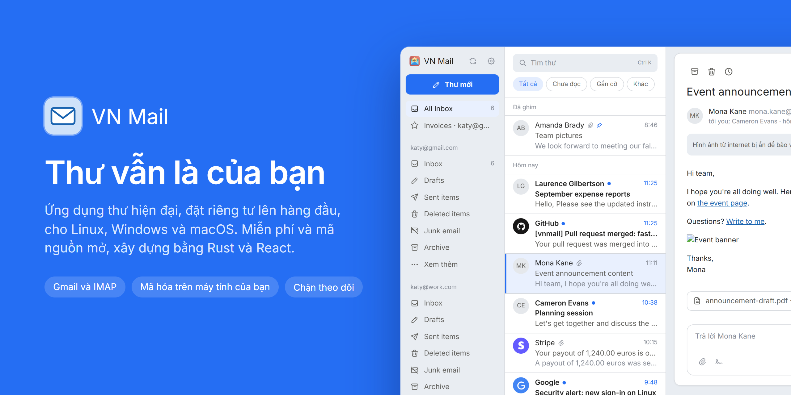
</p>

# VN Mail

> Một fork của [OpenWren](https://github.com/VinceGHER/openwren) (Apache-2.0),
> đổi tên cùng với icon và app identifier riêng. Kiểm tra cập nhật và đếm
> lượt dùng ẩn danh đã bị tắt: VN Mail không có máy chủ cho hai việc đó.

Ứng dụng thư hiện đại, đặt riêng tư lên hàng đầu, giữ thư của bạn trên máy
tính của bạn. Miễn phí và mã nguồn mở, cho [Linux, Windows và macOS](https://github.com/protungtq/vn-mail/releases).
Được xây dựng bằng **Rust** (engine: đồng bộ, tìm kiếm, mã hóa) và **React**
(giao diện), nên ứng dụng nhỏ và nhanh: bản tải về 14 MB, khởi động trong
khoảng nửa giây.

Gmail và mọi tài khoản IMAP, gom chung một hộp thư, tìm kiếm quay lại được
nhiều năm, kèm sẵn tính năng chống theo dõi và chống lừa đảo.

VN Mail do TungTQ duy trì. Báo lỗi, sửa lỗi và ý tưởng đều được đón nhận
trong [issues](https://github.com/protungtq/vn-mail/issues).

| Sáng | Tối |
| --- | --- |
| 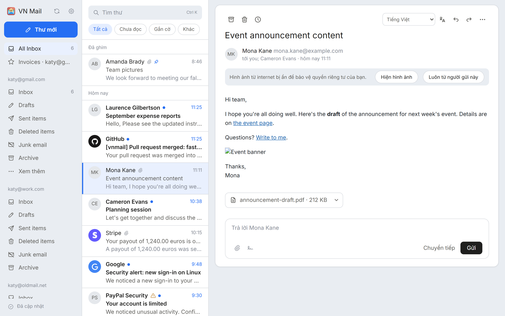 | 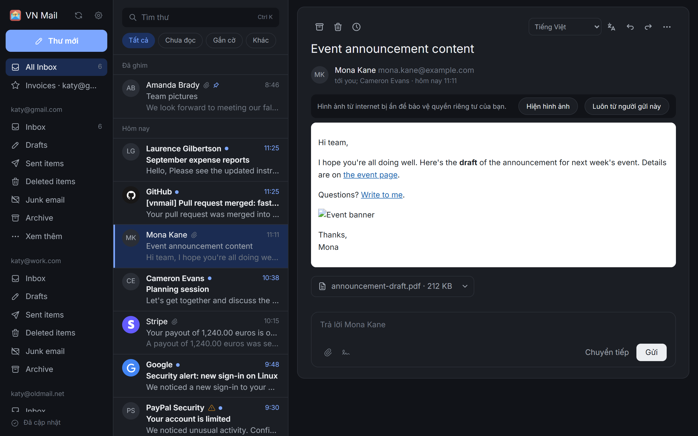 |

## Vì sao chọn VN Mail

- **Miễn phí.** Không mất tiền, không cần tài khoản với chúng tôi, không quảng cáo.
- **Mã nguồn mở.** Apache-2.0. Mọi dòng code đều công khai: đọc, build, fork tùy ý.
- **Ra đời từ OpenWren.** Tác giả của nó không tìm được ứng dụng thư nào cho Linux mà mình ưng, nên tự viết một cái: hiện đại, nhanh và riêng tư. VN Mail tiếp tục con đường đó.
- **Riêng tư.** Thư được mã hóa và lưu trên máy tính của bạn. Trình theo dõi bị gỡ bỏ và thư đáng ngờ được gắn cờ trước khi bạn bấm vào.

## Nhanh

Đo bằng benchmark của chính dự án này, trên hộp thư đã mã hóa gồm 200.000
thư (laptop Intel Core Ultra 7 155H, Ubuntu 26.04):

| | |
| --- | --- |
| Khởi động app đến khi hộp thư hiện lên | **0,6 giây** |
| Mở một thư mục | **0,1 ms** |
| Mở một thư | **0,05 ms** |
| Tìm một từ xuất hiện trong vài trăm thư | **30 ms** |
| Tìm một từ xuất hiện trong hầu hết hộp thư | 185 ms |
| Đồng bộ từ máy chủ nội bộ | 2.750 tiêu đề và 540 nội dung thư mỗi giây |
| Mức dùng CPU khi chạy nền trong tray | 0,2% một nhân |
| Bộ nhớ khi mở hộp thư | 288 MB, chủ yếu là web view của hệ thống |
| Bản tải về | 14 MB |

Thời gian mở thư mục và mở thư là thời gian làm việc của cơ sở dữ liệu trong
engine Rust; vẽ lên màn hình tính thêm. Thời gian khởi động, bộ nhớ và mức
dùng CPU khi chạy nền được đo trên hộp thư 50.000 thư.

Phương pháp, toàn bộ số liệu và cách chạy lại: [docs/benchmarks.md](docs/benchmarks.md).

## Cài đặt

Tải bộ cài cho hệ thống của bạn từ
[Releases](https://github.com/protungtq/vn-mail/releases).

### Windows

Cho Windows 10 và 11 64-bit. Đã kiểm thử trên Windows 11.

1. Tải file `*-setup.exe` rồi chạy.
2. Bộ cài chưa được ký bằng chứng chỉ, nên Windows có thể hiện
   "Windows protected your PC": chọn **More info**, rồi **Run anyway**.
3. Làm theo trình cài đặt. Nó chỉ cài cho người dùng hiện tại và không cần
   quyền quản trị.

### macOS

Cho mọi máy Mac, Apple silicon và Intel, macOS 11 trở lên. Đã kiểm thử trên
macOS 14 với chip Intel; chưa thử trên Apple silicon.

1. Tải file `.dmg`, mở ra rồi kéo VN Mail vào Applications.
2. Mở VN Mail. App chưa được ký bằng chứng chỉ Apple, nên macOS từ chối
   ở lần mở đầu tiên ("cannot be opened because Apple cannot check
   it for malicious software"). Bấm **OK**.
3. Mở Terminal, chạy lệnh này một lần, rồi mở lại VN Mail:

```bash
xattr -cr /Applications/VN Mail.app
```

### Linux

Fork này chưa phát hành gói Linux. Build từ mã nguồn,
như hướng dẫn bên dưới.

### Build từ mã nguồn

Trên Linux bạn cần Node.js 22 trở lên kèm pnpm, Rust 1.77 trở lên, và các
thư viện Linux của Tauri:

```bash
sudo apt install -y rustc cargo libwebkit2gtk-4.1-dev libgtk-3-dev libayatana-appindicator3-dev librsvg2-dev libssl-dev libxdo-dev pkg-config
```

```bash
pnpm install
```

```bash
pnpm tauri build --bundles deb
```

Gói deb nằm trong `src-tauri/target/release/bundle/deb/`. Để thêm app vào
menu mà không cần cài gói, chạy `sh scripts/install-launcher.sh`.

## Gỡ cài đặt

Gỡ gói sẽ gỡ luôn chương trình, mục menu và icon của nó:

```bash
sudo apt remove vnmail
```

```bash
sudo dnf remove vnmail
```

Như các app Linux khác, dữ liệu của bạn vẫn ở nguyên chỗ cũ, để khi cài lại
thì tài khoản và thư của bạn vẫn còn đó. Để xóa mọi thứ, thoát VN Mail trước
(icon tray → Quit), rồi xóa ba thứ sau.

| Cái gì | Ở đâu | Xóa bằng |
| --- | --- | --- |
| Thư đã tải, chỉ mục tìm kiếm, bản nháp và cài đặt (cơ sở dữ liệu đã mã hóa) | `~/.local/share/asia.so1.vnmail/` | `rm -rf ~/.local/share/asia.so1.vnmail` |
| Mục khởi động cùng hệ thống | `~/.config/autostart/vnmail.desktop` | `rm -f ~/.config/autostart/vnmail.desktop` |
| Mật khẩu tài khoản và khóa cơ sở dữ liệu | Keyring của hệ thống, dưới tên "VN Mail" | `secret-tool clear service VN Mail` |

`secret-tool` nằm trong gói `libsecret-tools` (Debian, Ubuntu) hoặc
`libsecret` (Fedora). Nếu không có nó, mở "Passwords and Keys", tìm
"VN Mail" rồi xóa các mục đó.

Việc này chỉ xóa bản sao trên máy tính này: thư của bạn vẫn còn trên máy chủ
thư. Không có khóa trong keyring thì không đọc được cơ sở dữ liệu, nên dù
file cơ sở dữ liệu còn sót lại cũng không đọc được.

Nếu bạn đã chạy `scripts/install-launcher.sh` từ mã nguồn, hoàn tác bằng
`sh scripts/install-launcher.sh remove`.

## Thêm hộp thư của bạn

- **Gmail:** chọn Google, rồi làm theo ba bước để tạo app password trong
  tài khoản Google của bạn (cần bật xác minh 2 bước). Nâng cao: đăng nhập
  bằng Google với OAuth client ID của riêng bạn.
- **Tài khoản khác:** nhập địa chỉ và mật khẩu; tên máy chủ được đoán từ
  địa chỉ và có thể sửa lại.

Mật khẩu được lưu trong keyring của hệ thống, không bao giờ nằm trong file
của VN Mail.

## Tính năng

<table>
<tr>
<td width="46%">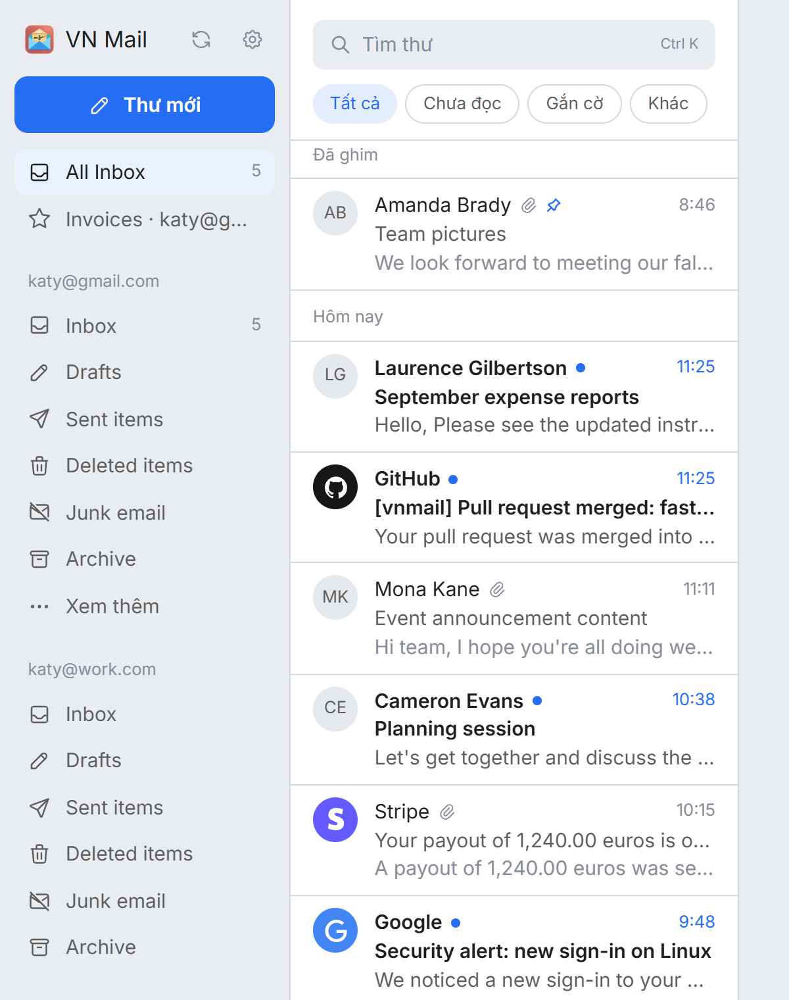</td>
<td>

**Mọi tài khoản, một hộp thư**

Gmail và mọi tài khoản IMAP đặt cạnh nhau. "All Inbox" hiện thư của mọi
tài khoản cùng lúc; gắn sao cho các thư mục hay dùng để giữ chúng ở trên cùng.

</td>
</tr>
<tr>
<td width="46%">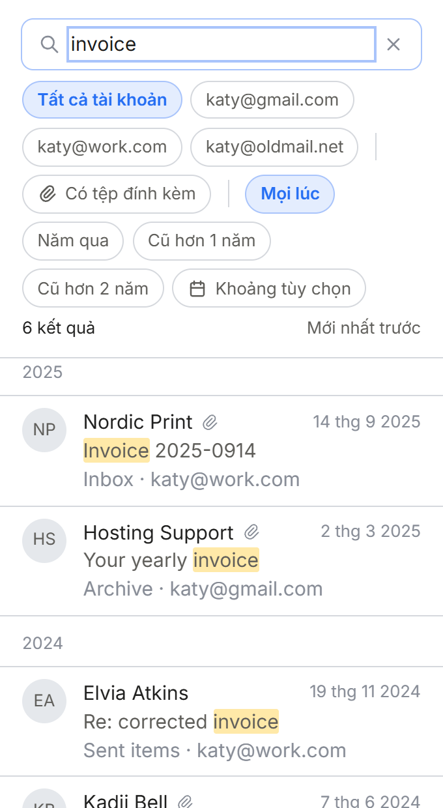</td>
<td>

**Tìm kiếm quay lại được nhiều năm**

Mọi thư đều được lập chỉ mục trên máy tính của bạn, dù cũ đến đâu. Thu hẹp
theo tài khoản, file đính kèm hoặc ngày tháng, hoặc gõ `from:`, `subject:`,
`has:attachment`, `before:2024-01-31`. Nội dung chưa tải về vẫn có thể tìm
trên máy chủ.

</td>
</tr>
<tr>
<td width="46%">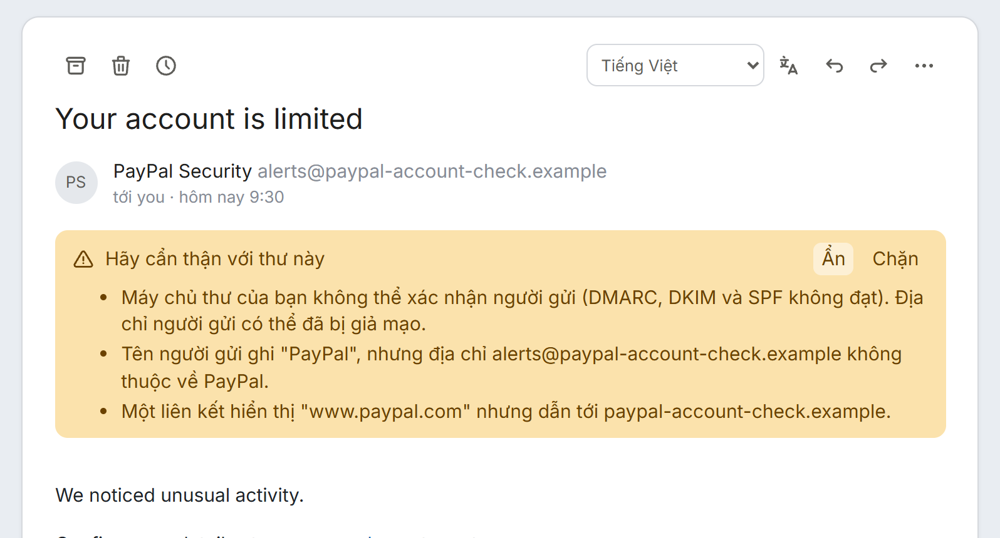</td>
<td>

**Cảnh báo trước khi bạn bấm vào**

Một thư sẽ bị gắn cờ khi máy chủ thư không xác nhận được người gửi, khi tên
hiển thị mạo danh một công ty mà địa chỉ không thuộc về, khi link hiện một
trang nhưng dẫn tới trang khác, hoặc khi địa chỉ bắt chước một địa chỉ quen
thuộc bằng chữ cái trông giống. Bấm một lần để chặn người gửi.

</td>
</tr>
<tr>
<td width="46%">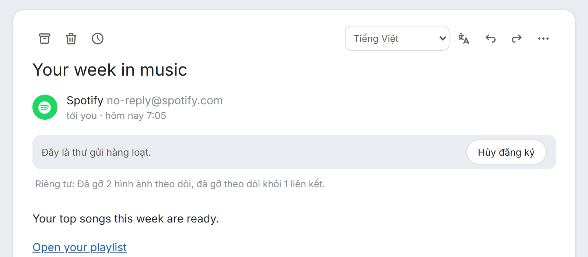</td>
<td>

**Gỡ trình theo dõi, gợi ý hủy đăng ký**

Ảnh ẩn chuyên báo cáo khi bạn mở thư sẽ bị gỡ, mã theo dõi trong link cũng
bị lược bỏ. Ảnh từ internet chỉ tải khi bạn yêu cầu. Thư quảng cáo có nút
Hủy đăng ký để gửi yêu cầu hủy thay bạn.

</td>
</tr>
<tr>
<td width="46%">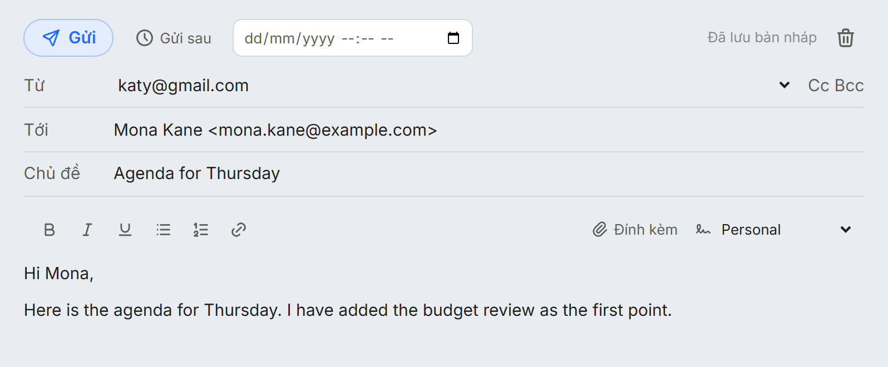</td>
<td>

**Viết thư nhẹ nhàng hơn**

Soạn thảo rich text, chữ ký (kèm ảnh nếu thích), file đính kèm, gửi sau,
và vài giây để hoàn tác sau khi gửi. Bản nháp được lưu trong lúc bạn gõ và
giữ trên máy chủ. Dưới mỗi thư đều có ô trả lời nhanh.

</td>
</tr>
<tr>
<td width="46%">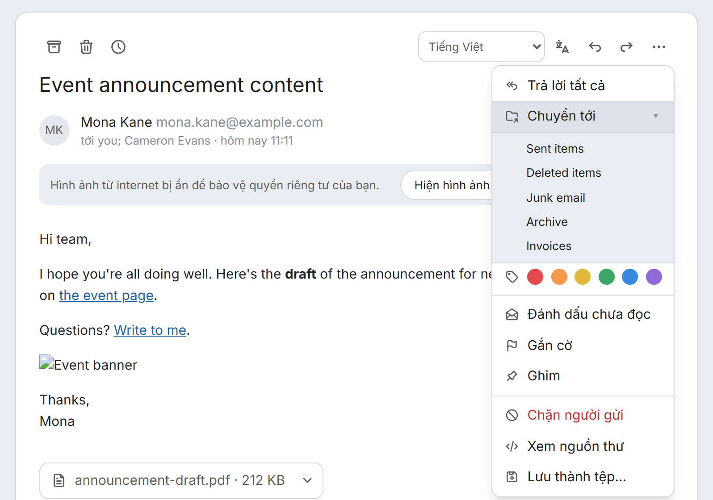</td>
<td>

**Nắm bắt mọi thứ**

Lưu trữ, xóa và báo lại sau chỉ bằng một lần bấm. Di chuyển bằng menu hoặc
kéo thả vào thư mục, đánh dấu bằng màu, ghim, gắn cờ, đặt quy tắc cho thư
mới, và hoàn tác mọi thao tác.

</td>
</tr>
<tr>
<td width="46%">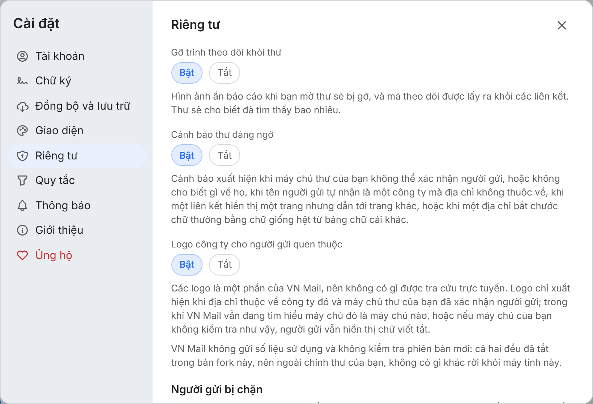</td>
<td>

**Riêng tư, và bạn có thể kiểm chứng**

Thư lưu trong cơ sở dữ liệu đã mã hóa; mật khẩu ở trong keyring của hệ
thống. Mọi biện pháp bảo vệ đều có công tắc, và VN Mail không tự gửi yêu
cầu nào cho riêng mình: không đếm lượt dùng, không kiểm tra cập nhật.

</td>
</tr>
<tr>
<td width="46%">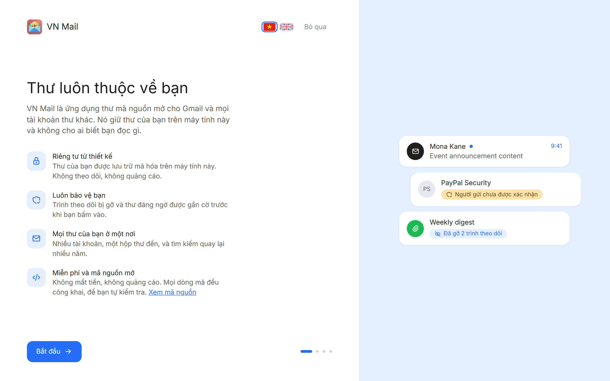</td>
<td>

**Cài đặt xong trong một phút**

Màn hình chào ngắn gọn giúp thêm tài khoản đầu tiên và chọn giao diện, cỡ
chữ, định dạng giờ. Giao diện sáng và tối, ba phông chữ, cùng icon tray
để thông báo thư mới luôn đến.

</td>
</tr>
</table>

## Riêng tư

VN Mail không có máy chủ nào của riêng mình để nhìn thấy thư của bạn. Nó chỉ
nói chuyện với máy chủ thư của bạn, và không nói với ai khác trừ khi bạn yêu
cầu (hiện ảnh từ xa, đăng nhập bằng Google, hủy đăng ký). Nó không gửi số liệu
sử dụng và không kiểm tra phiên bản mới: cả hai đều đã tắt trong fork này.

Mọi yêu cầu mà app thực hiện đều được liệt kê trong [PRIVACY.md](PRIVACY.md).

## Được xây dựng bằng

| Thành phần | Vai trò | Vì sao |
| --- | --- | --- |
| **Rust** | Engine: đồng bộ, phân tích, tìm kiếm, gửi, mã hóa | An toàn bộ nhớ và nhanh, không bị khựng vì garbage collection |
| **Tauri 2** | Cửa sổ, dùng WebKitGTK của hệ thống | Không kèm engine trình duyệt, nên bản tải về chỉ khoảng 14 MB |
| **SQLite + SQLCipher + FTS5** | Lưu trữ nội bộ, đã mã hóa, kèm tìm kiếm toàn văn | Một file duy nhất, không cần máy chủ cơ sở dữ liệu, tìm kiếm vẫn nhanh trên hộp thư lớn |
| **tokio, async-imap, lettre, mail-parser, ammonia, rustls, keyring** | Giao thức thư, phân tích, làm sạch HTML, TLS, thông tin đăng nhập | Các thư viện Rust nhỏ, chuyên một việc |
| **React 19, TypeScript, Vite, Tailwind CSS 4, zustand, TipTap** | Giao diện | Build nhanh và dễ thay đổi |

## Cách hoạt động

Giao diện không bao giờ chạm tới mạng hay cơ sở dữ liệu. Nó gọi các lệnh
trong engine Rust và lắng nghe sự kiện; mọi thứ bạn thấy đều được đọc từ
cơ sở dữ liệu nội bộ, nên danh sách và thư hiện ra ngay lập tức.

Với mỗi tài khoản, một tác vụ nền giữ cơ sở dữ liệu đồng bộ với máy chủ:

1. Gửi các thay đổi bạn đã làm (di chuyển, gắn cờ, bản nháp), xếp hàng nếu bạn đang ngoại tuyến.
2. Lấy danh sách thư mục, rồi tiêu đề và cờ của mọi thư mục, hộp thư đến trước.
3. Tải ngay nội dung của các thư mới nhất, phần còn lại tải dần trong nền.
4. Chờ máy chủ báo có thư mới (IMAP IDLE), thư mới đến trong một hai giây.

HTML của thư được làm sạch trong Rust, rồi hiển thị trong một khung sandbox
đã tắt script và chặn truy cập mạng cho tới khi bạn chọn "Show images".

```
src/                 interface (React, TypeScript)
  backend/           the only place that calls the engine; sample mail for `pnpm dev`
  features/          screens: folders, list, reading pane, composer, settings, welcome
src-tauri/src/       engine (Rust)
  lib.rs             commands the interface calls, background tasks
  sync.rs imap.rs    keeping the local database in step with the server
  db.rs              all the SQL
  parse.rs           reading and cleaning mail
  smtp.rs oauth.rs   sending, Google sign-in
stats/               the upstream usage counter (not used by this fork)
website/             the upstream project's site (not used by this fork)
```

## Kiểm thử

```bash
pnpm typecheck && pnpm test
```

```bash
cargo test --manifest-path src-tauri/Cargo.toml
```

Các kiểm thử end-to-end chạy với máy chủ thư Dovecot nội bộ (cần Docker):

```bash
sh tests/mail-server.sh
```

```bash
VNMAIL_TEST_IMAP=127.0.0.1:3143 VNMAIL_TEST_SMTP=127.0.0.1:3025 cargo test --manifest-path src-tauri/Cargo.toml
```

`pnpm dev` chạy giao diện trong trình duyệt với thư mẫu, không cần máy chủ
thư hay app desktop. `node scripts/screenshots.mjs` chụp mọi ảnh trong
README này từ đó, kể cả ảnh bìa.

## Đóng góp

Báo lỗi, sửa lỗi và ý tưởng đều được đón nhận. Xem [CONTRIBUTING.md](CONTRIBUTING.md)
để biết cách build, kiểm thử và gửi thay đổi, và [SECURITY.md](SECURITY.md) để
báo cáo lỗ hổng bảo mật một cách riêng tư.

## Giới hạn đã biết

- Windows và macOS mới hơn Linux và ít được kiểm thử hơn: Windows đã thử
  trên Windows 11, macOS chỉ trên máy Mac Intel. Bộ cài của chúng chưa được
  ký bằng chứng chỉ, nên cả hai hệ thống đều cảnh báo ở lần khởi động đầu.
- "Sign in with Google" một chạm cho mọi người cần Google phê duyệt app,
  việc này chưa được yêu cầu. Tạm thời Gmail dùng app password.
- Chuyên mục, thư ghim và báo lại sau chỉ lưu trên máy tính này, không lưu
  trên máy chủ.
- Tìm kiếm phía máy chủ chỉ hiểu từ ASCII không dấu.
- Thư HTML luôn hiển thị trên nền trắng, cả trong giao diện tối.
- Chặn một người gửi sẽ di chuyển thư của họ khi VN Mail đồng bộ, nên chỉ
  có tác dụng khi app đang chạy.
- Chưa có Flatpak.

## Giấy phép

[Apache-2.0](LICENSE). Tên "OpenWren" và logo thuộc về dự án upstream và
không nằm trong giấy phép đó; xem [TRADEMARKS.md](TRADEMARKS.md).
Các thành phần bên thứ ba được liệt kê trong
[THIRD-PARTY-NOTICES.md](THIRD-PARTY-NOTICES.md).
